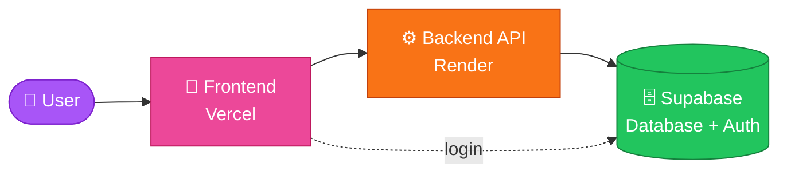

<div align="center">


<a href="https://frontend-tawny-eight-63.vercel.app">
  
</a>

<br />

[](https://frontend-tawny-eight-63.vercel.app)
[](https://hello-festive-api.onrender.com/api/health)
[](https://frontend-tawny-eight-63.vercel.app/events)

<br />


</div>

<br />

> ⏳ **Heads up:** the backend runs on a free Render instance that sleeps when idle. The first load can take **30 to 60 seconds**. After that, it is fast.

---

## 🌈 What is Hello Festive?

**Hello Festive** helps students and neighbours find what is happening around them. Search by event name or city, save the ones you love, and host your own event so the right people find it.

<table>
<tr>
<td align="center" width="25%">🎓<br /><b>College Fests</b><br /><sub>Cultural and tech fests</sub></td>
<td align="center" width="25%">💻<br /><b>Hackathons</b><br /><sub>Build, compete, win</sub></td>
<td align="center" width="25%">🛠️<br /><b>Workshops</b><br /><sub>Learn something new</sub></td>
<td align="center" width="25%">🎪<br /><b>Local Events</b><br /><sub>Festivals near you</sub></td>
</tr>
</table>

---

## ✨ Features

<table>
<tr>
<td width="50%" valign="top">

### 🙋 For Attendees

| | |
|:-:|---|
| 🔍 | Search by name, city, category, price and date |
| ❤️ | Save favourite events |
| 🗺️ | See events on a map |
| 🏷️ | Browse by category |
| 🔐 | Secure login and forgot password |

</td>
<td width="50%" valign="top">

### 🎤 For Organizers

| | |
|:-:|---|
| ➕ | Create an event in minutes |
| 🖼️ | Upload a poster (JPG, PNG, WebP, 3 MB) |
| ✏️ | Edit or delete your own events |
| 📣 | Reach students and locals for free |
| 🛡️ | Admin panel removes fake events |

</td>
</tr>
</table>

---

## 🧰 Tech Stack

| Layer | Technology | Hosted on |
|:-:|---|:-:|
| 🎨 **Frontend** | React, Vite, Leaflet + OpenStreetMap |  |
| ⚙️ **Backend** | Node.js, Express |  |
| 🗄️ **Database, Auth, Storage** | Supabase (PostgreSQL) |  |

### 🏗️ How it fits together



---

## 📁 Project Structure

```
hello-festive/
├── 🎨 frontend/    React + Vite app        (deployed on Vercel)
├── ⚙️ backend/     Express API             (deployed on Render)
└── 🗄️ database/    schema.sql for Supabase
```

---

## 💻 Run Locally

<details>
<summary><b>👉 Click to open the setup guide</b></summary>

<br />

### 📋 Requirements

- Node.js 20 or newer (`node -v`)
- A Supabase project with `database/schema.sql` run in the SQL Editor
- **Data API** enabled in Supabase

### 🔑 Step 1: Get your Supabase values

Supabase dashboard → **Project Settings → API Keys**

| Value | Used in | Secret? |
|---|:-:|:-:|
| Project URL | backend + frontend | 🟢 No |
| Publishable key (anon) | frontend | 🟢 No |
| Secret key (service_role) | backend only | 🔴 **Yes, never share** |

### 📝 Step 2: Create the `.env` files

Copy `.env.example` to `.env` in both folders and fill them in.

**backend/.env**

```env
PORT=5000
CLIENT_URL=http://localhost:5173
SUPABASE_URL=https://xxxx.supabase.co
SUPABASE_SERVICE_ROLE_KEY=your-secret-key
```

**frontend/.env**

```env
VITE_SUPABASE_URL=https://xxxx.supabase.co
VITE_SUPABASE_ANON_KEY=your-publishable-key
VITE_API_URL=http://localhost:5000/api
```

> 🔒 Never commit `.env` files, and never put real keys in `.env.example`.

### 🔗 Step 3: Supabase login settings

**Authentication → URL Configuration**

- Site URL: `http://localhost:5173`
- Redirect URLs: `http://localhost:5173/**`

### ▶️ Step 4: Start both servers

```bash
# Terminal 1: backend
cd backend
npm install
npm run dev
```

```bash
# Terminal 2: frontend
cd frontend
npm install
npm run dev
```

Open **http://localhost:5173** 🎉

### 👑 Step 5: Make yourself admin

Register on the site, then run this in the Supabase **SQL Editor**:

```sql
update public.profiles set role = 'admin'
where id = (select id from auth.users where email = 'your-email@example.com');
```

Log out and in again. An **Admin panel** link appears in your profile menu.

</details>

---

## 🚀 Deployment

<details>
<summary><b>👉 Click to see how it is deployed</b></summary>

<br />

### ⚙️ Backend → Render (Web Service)

| Setting | Value |
|---|---|
| Root Directory | `backend` |
| Build Command | `npm install` |
| Start Command | `node src/server.js` |
| Instance Type | Free |

```env
SUPABASE_URL=https://xxxx.supabase.co
SUPABASE_SERVICE_ROLE_KEY=your-secret-key
CLIENT_URL=https://your-frontend.vercel.app
```

Do not set `PORT`, Render sets it. `CLIENT_URL` must match the frontend link exactly, with no `/` at the end.

### 🎨 Frontend → Vercel

| Setting | Value |
|---|---|
| Root Directory | `frontend` |
| Framework Preset | Vite |

```env
VITE_SUPABASE_URL=https://xxxx.supabase.co
VITE_SUPABASE_ANON_KEY=your-publishable-key
VITE_API_URL=https://your-backend.onrender.com/api
```

`frontend/vercel.json` keeps page refresh and direct links working.

### 🗄️ Supabase URLs for production

**Authentication → URL Configuration**

- Site URL: your Vercel link
- Redirect URLs: `https://your-frontend.vercel.app/**`

Every `git push` to `main` redeploys both Vercel and Render automatically. 🔄

</details>

---

## 📡 API Reference

<details>
<summary><b>👉 Click to see all endpoints</b></summary>

<br />

| Method | Endpoint | Access | Description |
|:-:|---|:-:|---|
|  | `/api/health` | 🌍 Public | Health check |
|  | `/api/events` | 🌍 Public | Search and filter (`q`, `city`, `category`, `type`, `price`, `when`, `page`, `limit`) |
|  | `/api/events/suggest?q=` | 🌍 Public | Event name autocomplete |
|  | `/api/events/:id` | 🌍 Public | Single event |
|  | `/api/categories` | 🌍 Public | Categories with event counts |
|  | `/api/locations/suggest?q=` | 🌍 Public | City autocomplete |
|  | `/api/stats` | 🌍 Public | Numbers for the home page |
|  | `/api/events` | 🔐 Logged in | Create event |
|  | `/api/events/mine` | 🔐 Logged in | My events |
|   | `/api/events/:id` | 👤 Owner / Admin | Edit or delete |
|    | `/api/bookmarks` | 🔐 Logged in | Saved events |
|  | `/api/admin/events` | 🛡️ Admin | All events |

</details>

---

## 🛠️ Troubleshooting

<details>
<summary><b>👉 Something not working? Click here</b></summary>

<br />

| 😵 Problem | ✅ Fix |
|---|---|
| "Supabase keys are missing" banner | Check `frontend/.env` and restart `npm run dev` |
| Backend stops with "Missing SUPABASE_URL" | Check `backend/.env` or the Render environment variables |
| "Cannot reach the server" | Backend is off or waking up, or `VITE_API_URL` is wrong |
| CORS error in the console | `CLIENT_URL` on the backend does not match the frontend link |
| "Something went wrong on the server" | Check backend logs. Confirm `schema.sql` ran and Data API is on |
| Confirmation link opens localhost | Set the Supabase Site URL to your live link |
| Poster upload fails | Be logged in and keep the file under 3 MB |
| Port already in use | Close the other terminal or change `PORT` in `backend/.env` |

</details>

---

<div align="center">

### 💜 Made with love by **Kashish**

[](https://frontend-tawny-eight-63.vercel.app)

⭐ **Star this repo if you like it!** ⭐


</div>
